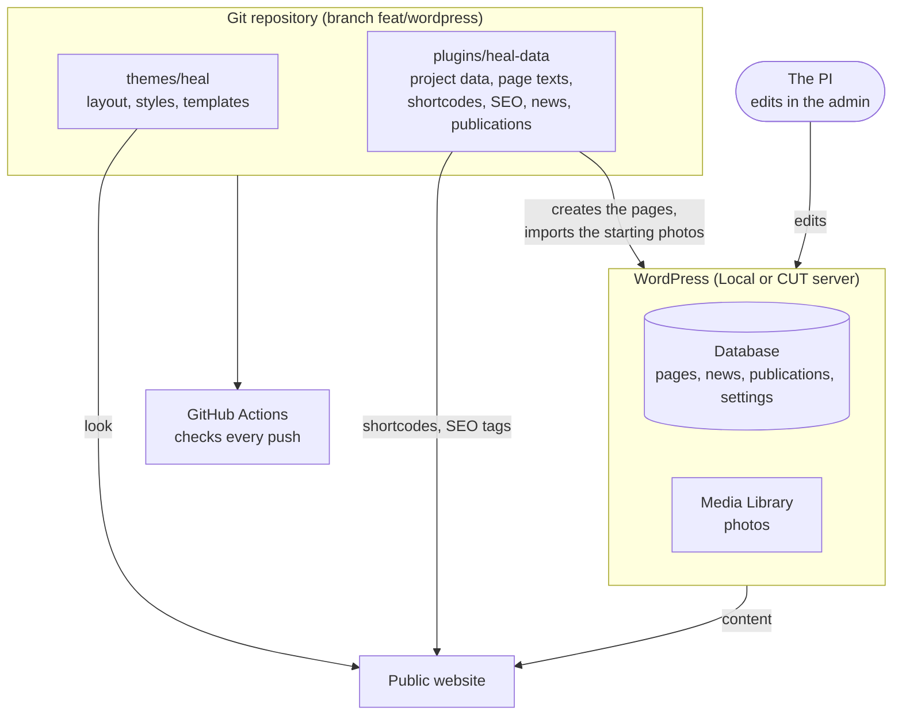

# HEAL — WordPress site

WordPress version of the HEAL project website (COM-B & Exposome Partnership for Health Engagement,
RIF POST-DOC/0925/ROandOther/0027). It is a port of the Astro site from the `develop` branch of this repository.

This branch has its own history and is never merged into `main` or `develop`.
It holds only our own code; WordPress core and third-party plugins are not stored here.

## How it fits together



- **Theme** (`themes/heal`) decides how things look. It holds no project data.
- **Plugin** (`plugins/heal-data`) holds the project data, the page texts and the logic
  (deliverable status, news and publication lists, SEO tags). It works with any theme.
- **Database**: pages, news posts, publications and settings. This is what the PI edits in the admin.
- **Media Library**: photos. The PI adds and replaces them in the admin.
- **GitHub Actions** checks every push (see [Checks](#checks)).

## Contents

```
themes/heal/          HEAL theme: layout, styles, navigation (renders data, holds no project data)
plugins/heal-data/    HEAL Data plugin: project data, shortcodes, page content, SEO, gallery, news, publications
scripts/check.mjs     Checks for data and content rules (runs in CI)
.github/workflows/    CI
```

### HEAL theme (`themes/heal`)

| File | Purpose |
|---|---|
| `style.css` | Theme header and all styles; fonts are self-hosted (no Google requests, GDPR) |
| `functions.php` | Theme setup, navigation, language switch, helpers |
| `header.php`, `footer.php` | Site header and footer |
| `front-page.php` | Home page |
| `page.php`, `page-gallery.php` | Regular pages; the gallery page is wider |
| `single.php`, `index.php` | One news post; fallback (archives, tags, 404) |
| `assets/gallery.js` | Photo viewer (lightbox) for Gallery and Image blocks |
| `assets/nav.js` | Mobile menu |
| `assets/editor.css` | Makes the block editor look like the site |
| `assets/` | Fonts, logo, language icons |

The theme still renders if the HEAL Data plugin is off, but without project data.

### HEAL Data plugin (`plugins/heal-data`)

| Path | Purpose |
|---|---|
| `data/*.json` | Deliverables, work packages, milestones, partners |
| `data/gallery/` | Starting photos (imported into the Media Library once), see its README |
| `content/pages/*.html` | Content of the site pages, as WordPress block markup |
| `includes/config.php` | Project facts (name, project number, contact email, public deliverables) |
| `includes/data.php` | Reads the JSON files and gives the shortcodes their lists (public deliverables only) |
| `includes/status.php` | Deliverable status (Planned / In progress / Published) from the project month |
| `includes/settings.php` | "HEAL project start date" field in **Settings → General** |
| `includes/shortcodes.php` | Shortcodes for results, consortium, project number, contact email |
| `includes/contact.php` | Contact form (`[heal_contact_form]`): emails the message to the project address, stores nothing, spam protection without third parties |
| `includes/workplan.php` | Timeline, work package cards and the five work package pages (`/work-plan/wp1/` ...), built from the data |
| `includes/pages.php` | Creates the pages and refreshes the ones nobody edited |
| `includes/gallery.php` | Imports the starting photos and builds the Gallery page from blocks |
| `includes/news.php` | News list (`[heal_news]`) |
| `includes/publications.php` | "Publications" in the admin and the list on the Results page |
| `includes/seo.php` | Page titles, meta descriptions, Open Graph, structured data (ResearchProject) |
| `includes/hardening.php` | Hides usernames and the WordPress version, turns off comments and XML-RPC, sends basic security headers |

Shortcodes:

| Shortcode | Output |
|---|---|
| `[heal_results]` | Table of public deliverables with status, then the publications |
| `[heal_timeline]` | The 24 months as bars, one row per work package, with milestones (and the current month once the start date is set) |
| `[heal_work_plan]` | The five work packages as cards, each linking to its own page |
| `[heal_wp id="WP1"]` | One work package: objective, tasks on a timeline, milestones, public deliverables |
| `[heal_consortium]` | Partners |
| `[heal_news]` | Latest news posts, 6 per page |
| `[heal_publications]` | Publication list |
| `[heal_logos]` | HEAL logo variants (orange, negative, monochrome, white) with SVG and PNG downloads (Media kit); files in `assets/brand/` |
| `[heal_project_number]` | Grant project number |
| `[heal_contact_email]` | Contact email link |
| `[heal_contact_form]` | Contact form (Contact page) |

## Requirements

- WordPress 7.1+
- PHP 8.0+

The local site also has Elementor, TablePress and TranslatePress installed.
The HEAL theme and plugin do not depend on them.

## Languages

The site is in English. The EN / EL switch in the header is in place, but the Greek version is not translated yet
(planned for version 1.1). Until then "EL" only links to the home page. With the Polylang plugin active the
switch uses its real language URLs.

## Local setup

1. Create a WordPress site (for example with [Local](https://localwp.com/)).
2. Copy (or link, see below) the folders into the site's `wp-content`:
   - `themes/heal` → `wp-content/themes/heal`
   - `plugins/heal-data` → `wp-content/plugins/heal-data`
3. In the admin:
   - **Plugins** → activate **HEAL Data**.
   - **Appearance → Themes** → activate **HEAL**.
   - **Settings → Permalinks** → choose **Post name** (pages use `/project/`, `/work-plan/` and so on).
   - **Settings → General** → set **HEAL project start date**. Empty means every deliverable shows "Planned".
4. Open the site once: the plugin creates the pages from `content/pages/`.
   The first visits are slower because the starting photos are imported into the Media Library
   (a few per request).

### Working without copying files

Instead of copying, link the folders from the repository into `wp-content`
(Windows, PowerShell, after removing the copies from `wp-content`; stop the site in Local first):

```
New-Item -ItemType Junction -Path "<site>\wp-content\themes\heal" -Target "<repo>\themes\heal"
New-Item -ItemType Junction -Path "<site>\wp-content\plugins\heal-data" -Target "<repo>\plugins\heal-data"
```

To remove a link later use `cmd /c rmdir "<path>"`. Never `Remove-Item -Recurse` on a link: it can delete the repository files.

The links work only while this branch is checked out. To keep the Astro branches available at the same time,
check this branch out in a separate folder with `git worktree add ../Project-HEAL-wp feat/wordpress`
and link to that folder.

## Editing the site (for the PI)

| What | Where in the admin |
|---|---|
| A page | **Pages → Edit**. Pages are made of normal blocks (headings, paragraphs, lists). |
| The description Google shows for a page | The **Excerpt** box of the page. If empty, a ready-made text is used. |
| News | **Posts → Add New**: title, text, tags, featured image. It appears on the News page and in the RSS feed (`/feed/`). The featured image is the preview image when the link is shared. |
| A publication | **Publications → Add publication**: title, then authors, journal, year, DOI, open access, deliverable. It appears under "Publications" on the Results page. |
| Photos | Open the **Gallery** page and use the Gallery blocks. Photos come from the **Media Library**; write the alt text and caption (photographer credit). |
| Project start date | **Settings → General → HEAL project start date**. Deliverable statuses are calculated from it. |

Texts that are still drafts have an orange "Draft" note at the top. Delete the note when the text is approved.

### Blocks that come from data

Some blocks in the editor show only a grey **Shortcode** box (for example `[heal_wp id="WP1"]`). They are filled in
from the project data when the page is shown, so the text is **not** edited in the editor:

| Shortcode | Where | Changed by |
|---|---|---|
| `[heal_timeline]`, `[heal_work_plan]`, `[heal_wp id="WP1"]` … | Work plan and the five work package pages | `data/workPackages.json`, `milestones.json` (developers) |
| `[heal_results]` | Results table | `data/deliverables.json` (developers); the publications list is edited in **Publications** |
| `[heal_consortium]` | Consortium partners | `data/partners/*.json` (developers) |
| `[heal_news]`, `[heal_logos]` | News list, Media kit logos | **Posts**; the logo files in `assets/brand/` |

The pages are not locked: the PI can add normal blocks (paragraphs, images, lists) **above or below** a shortcode block.
This keeps the timeline, the cards and the work package pages always consistent with each other.

## Changing content (developers)

- **Project data** (deliverables, work packages, milestones, partners): edit `plugins/heal-data/data/*.json`.
- **Project facts** (project number, contact email, public deliverables): edit `plugins/heal-data/includes/config.php`.
- **Page text**: pages are created from `content/pages/*.html`. An existing page is refreshed from its file
  only if nobody edited it in the admin (the plugin stores a hash of what it wrote). To publish a text change to
  existing pages, edit the file and increase `HEAL_PAGES_VERSION` in `includes/pages.php`.
- **New pages**: add the HTML file and an entry in `heal_page_list()` in `includes/pages.php`,
  then increase `HEAL_PAGES_VERSION`.
- In page files, `{home}` is replaced with the site URL (write `href="{home}/contact/"`, never `href="/contact/"`).

## Contact form

`[heal_contact_form]` on the Contact page (US-05).

- The message goes by email to `contactEmail` in `includes/config.php`. While that is still `TODO@…`, messages go to
  the site admin email (**Settings → General**), so the form can be tested.
- Nothing is saved in the database. The reply goes straight to the visitor (Reply-To).
- Spam protection without third-party services: a hidden honeypot field, a signed form token (at least 3 seconds
  to fill in, valid for 2 days) and at most 5 messages per hour from one connection (a hash of the IP address,
  deleted after one hour).
- Mail is sent with `wp_mail()`. Local catches outgoing mail in **Local → Tools → Mailpit**. On a server that
  cannot send mail, install an SMTP plugin (for example WP Mail SMTP) with the CUT mail server.

## Checks

`.github/workflows/ci.yml` runs on every push and pull request to this branch:

- **PHP syntax** on PHP 8.0 and 8.3.
- **`scripts/test.php`** (PHP 8.0 and 8.3): tests of the project month, the deliverable status and DOI cleaning.
  Run it locally with `php scripts/test.php`. It needs no WordPress and no extra tools.
- **JavaScript syntax** of the theme scripts.
- **`scripts/check.mjs`**: data and content rules. Run it locally with `node scripts/check.mjs`. It checks that
  - the JSON data is valid and consistent (14 deliverables, 5 work packages, valid months and references),
  - only D4, D10, D11, D12 and D14 are public and confidential deliverables have no file (table B4.4),
  - the page files have balanced block markup, working links and existing shortcodes,
  - the texts follow the content rules of the sprint plan (6-month intervention, D1–D14 numbering,
    Limassol as end user, no unconfirmed names).

## Deploying to a server

1. Zip the two folders (PowerShell, from the repository root). Use `tar`, not `Compress-Archive`:
   Windows PowerShell 5.1 writes `\` into the zip and servers reject it.
   ```
   tar -a -c -f heal-theme.zip -C themes heal
   tar -a -c -f heal-data-plugin.zip -C plugins heal-data
   ```
   The plugin zip is about 4.5 MB, most of it the starting photos in `data/gallery/images/`.
   If the server's upload limit is lower, compress the photos first.
2. **Appearance → Themes → Add New → Upload Theme**, then **Plugins → Add New → Upload Plugin**; activate both.
   On a WordPress Multisite only the network administrator can upload; ask CUT IT.
3. **Settings → Permalinks** → **Post name**.
4. **Settings → Reading**: the option "Discourage search engines" must be **off** at launch.
5. Set the site title (HEAL) and **Settings → General → HEAL project start date**.
6. Open the site once so the pages are created and the starting photos are imported.

## What is not in Git

- WordPress core and `wp-config.php` (database passwords)
- Third-party themes and plugins
- `wp-content/uploads/` (media)
- The database: pages edited in the admin, news, publications, menus and settings. Move them with the export in Local
  or a migration plugin.

The `.gitignore` allows only `themes/heal/`, `plugins/heal-data/`, `scripts/` and `.github/`,
so other files cannot be committed by mistake.

## For the server administrators (CUT IT)

The plugin cannot do these, they belong to the server:

- HTTPS and the `Strict-Transport-Security` header (HSTS).
- A `Content-Security-Policy` header.
- Hiding `readme.html` and `license.txt` in the WordPress folder (they show the WordPress version).
- Blocking `xmlrpc.php` completely (the plugin already removes its methods).

## Known accessibility exception

The orange buttons (`.btn--solid`, e.g. "Participate", "Send message") keep the brand orange `#d97a2b` with white
text. That is a contrast of **3.1:1**, below the WCAG 2.1 AA minimum of 4.5:1 for normal text (NFR-A11Y), so axe
reports it. The team decided to keep the brand colour (November 2026). Everything else checked passes AA.
To fix it later, change one line in `themes/heal/style.css`: `--orange-bg: #b35a14;` (4.8:1).

## Still open

Waiting for the PI or CUT: access to the WordPress server and permission to install the theme and plugin,
the contact email (also where the contact form sends messages), the data protection officer's contact, the official funding logos, the project start date,
approval of the page texts.
