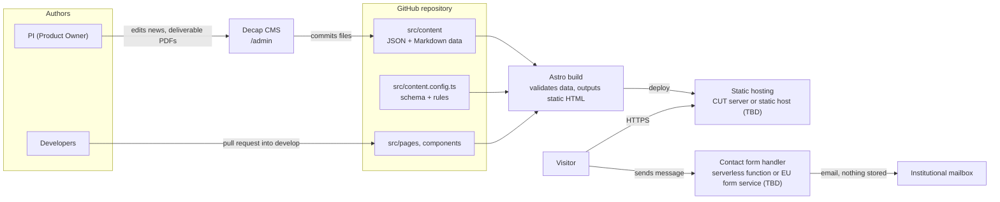

# HEAL Website — Architecture (draft v1)

## Key decisions

- **Static site (Astro + TypeScript).** No server or database to maintain after handover.
- **Content in Git.** Work packages, deliverables, milestones, news and team are versioned JSON/Markdown files with a schema; invalid data fails the build.
- **Decap CMS.** The PI edits content in the browser; every change is a Git commit and can be reverted.
- **No personal data stored.** The contact form forwards messages to the institutional email; no tracking cookies.

## Open items

- Hosting: CUT server or static hosting (PI + CUT IT).
- CMS login in production: GitHub OAuth, depends on hosting (Day 7).
- Contact form provider: serverless function or EU form service (Day 8).
